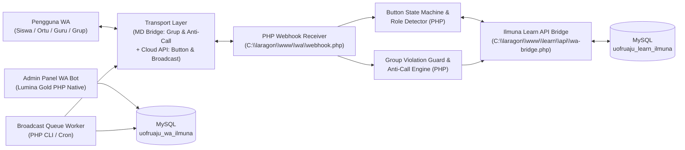

  # 🤖 ILMUNA WA BOT
  ### Platform WhatsApp Bot PHP Native Berbasis Interactive Button, Broadcast, Moderasi Grup & Integrasi SIAKAD Ilmuna Learn

  

    
    
    
    
    
  

---

## 📑 Daftar Dokumen Proyek (`C:\laragon\www\wa bot`)

| Dokumen | Fungsi |
|---|---|
| [`README.md`](README.md) | Single Source of Truth arsitektur, fitur, alur tombol interaktif, dan standar UI |
| [`IMPLEMENTATION_PLAN.md`](IMPLEMENTATION_PLAN.md) | Rencana implementasi bertahap (Fase 1–7), struktur folder, dan checklist verifikasi |
| [`DATABASE_SCHEMA.sql`](DATABASE_SCHEMA.sql) | Skema lengkap 14 tabel MySQL InnoDB (`utf8mb4`) siap migrasi |
| [`API_INTEGRATION.md`](API_INTEGRATION.md) | Kontrak API HMAC-SHA256 dua arah antara **Ilmuna Learn** (`C:\laragon\www\learn`) dan **Ilmuna WA Bot** (`C:\laragon\www\wa bot`) |

---

## 1. 🎯 Visi & Karakteristik Utama

**Ilmuna WA Bot** adalah mesin otomasi WhatsApp berbasis **PHP 8.2+ Native** yang dirancang khusus sebagai perpanjangan komunikasi *real-time* dari ekosistem **Ilmuna Learn (`C:\laragon\www\learn`)** dan **Margo One SSO (`C:\laragon\www\SSO`)**.

### Prinsip Inti:
1. **100% Interactive Button & List Menu (Tanpa Ketik Perintah Manual):**
   - Pengguna (Orang Tua, Siswa, Guru, Guru BK, Admin) **tidak perlu menghafal perintah teks** seperti `!nilai`, `/absen`, atau `#menu`.
   - Cukup menyapa sekali (atau klik tombol pemicu), bot langsung membalas dengan **Tombol Interaktif (Reply Buttons / List Menu / CTA URL Button)** sesuai **Role** yang terdeteksi otomatis dari nomor WhatsApp di database Ilmuna Learn.
2. **Tidak Dapat Di-Call (Anti-Call Auto-Reject):**
   - Semua panggilan suara (*voice call*) maupun video (*video call*) ke nomor bot otomatis ditolak seketika (*auto-reject*).
   - Bot langsung membalas pesan sopan disertai tombol `[📋 Buka Menu Utama]` dan `[📞 Hubungi Admin Sekolah]`.
   - Dilengkapi *Auto-Block / Cooldown* opsional apabila nomor yang sama melakukan *spam call* berulang (misal ≥ 3× dalam 5 menit).
3. **Deteksi Pelanggaran Otomatis di Grup WhatsApp (Group Guard):**
   - Memantau seluruh grup kelas/orang tua/sekolah secara otomatis:
     - **Anti-Kata Kasar & Toxic** (daftar kata terlarang + regex variasi ejaan).
     - **Anti-Link Berbahaya / Judol / Phishing / Invite Grup Lain** (whitelist domain resmi `ilmuna.my.id`, `google.com`, dsb.).
     - **Anti-Spam / Flood** (batas pesan beruntun per menit) & **Anti-Virtex** (pesan karakter ekstrem).
     - **Quiet Hours (Jam Malam Grup)** — pengingat otomatis atau hapus pesan di luar jam aktif grup.
   - **Eskalasi Berjenjang:** Peringatan 1 → Peringatan 2 → Hapus Pesan + Mute/Keluarkan Anggota + **Catat otomatis ke `catatan_pelanggaran_siswa` di Ilmuna Learn** & kirim notifikasi WA ke Orang Tua jika nomor pelaku terdaftar sebagai siswa.
4. **Broadcast Terjadwal, Auto-Broadcast Akademik & Anti-Banned (Queue Worker):**
   - **Broadcast Manual & Terjadwal** ke: *Semua Orang Tua*, *Orang Tua per Kelas*, *Semua Siswa*, *Siswa per Kelas*, *Semua Guru*, atau *Grup WhatsApp Kelas*.
   - **Auto-Broadcast Terintegrasi Data Ilmuna Learn:**
     - **Tugas (`tugas`)** — broadcast otomatis saat guru menerbitkan tugas baru + pengingat tenggat (H-1 & H-0) ke siswa, orang tua, dan grup kelas.
     - **Proyek P5/PPRA (`proyek`)** — broadcast proyek baru, pembagian kelompok, pengingat tenggat pengumpulan, dan informasi proyek.
     - **Agenda & Kalender Pendidikan (`kalender_pendidikan`, agenda sekolah)** — broadcast otomatis agenda harian/mingguan, jadwal libur, PHBI, rapat orang tua, dan kegiatan sekolah.
     - **Asesmen, Ujian CBT & LKPD (`asesmen_diagnostik`, `asesmen_formatif`, `asesmen_sumatif`, `lkpd`, `pengayaan_remedial`)** — broadcast jadwal ujian/asesmen, pengingat sesi CBT, dan remedial/pengayaan.
     - **Materi Baru (`materi`, `modul_ajar`) & Pengingat Mutaba'ah Yaumiyah (`mutabaah_logs`)** — opsional per kelas/jadwal harian.
     - **Formulir Publik Ter-Hash (`public_form_links`)** — broadcast 1-klik tautan `form-siswa?h=...` dan `form-guru?h=...`.
   - Mendukung personalisasi variabel (`{nama}`, `{kelas}`, `{nama_anak}`, `{judul}`, `{tenggat}`, `{link_learn}`), lampiran gambar/PDF, **tombol CTA/Quick Reply**, serta **antrean *rate-limiting* + jeda acak (3–7 detik)** untuk menjaga reputasi nomor WA.
5. **Integrasi Penuh Dua Arah dengan Ilmuna Learn:**
   - **Learn → WA Bot (Push Notifikasi):** Absensi (Alpa/Terlambat/Sakit/Izin), Catatan Pelanggaran BK, Pengajuan & Approval Perizinan (GPS + Bukti Foto), Tugas & Proyek Baru, Pengingat Tenggat H-1, dan Distribusi Link Formulir Publik Ter-Hash (`form-siswa?h=...`, `form-guru?h=...`).
   - **WA Bot → Learn (Aksi Langsung dari Tombol WA):** Orang Tua memantau nilai/absensi/pelanggaran/perizinan tiap anak (termasuk **multi-anak**); Guru/Wali Kelas menekan tombol `[✅ Setujui Izin]` atau `[❌ Tolak Izin]` langsung dari chat WA dan status langsung terbarui di database Ilmuna Learn.

---

## 2. 🏗️ Arsitektur Sistem (PHP Native + Dual Transport Adapter)

> [!IMPORTANT]
> **Catatan Teknis Penting WhatsApp API:**
> - **Meta WhatsApp Cloud API (Resmi)** mendukung *Interactive Reply Buttons*, *List Menu*, *CTA URL*, dan *Broadcast Template* resmi tanpa risiko ban, **namun tidak mendukung masuk Grup WhatsApp maupun event Call-Reject di grup**.
> - **Self-Hosted Multi-Device Bridge** (seperti **WAHA / Baileys / Go-WhatsApp / Evolution API**) mendukung penuh **Moderasi Grup (baca/hapus pesan/kick)** dan **Auto-Reject Incoming Call**, serta *Interactive Buttons / Poll Fallback*.
> - Oleh karena itu, **Ilmuna WA Bot PHP** dirancang menggunakan pola **Transport Adapter (`DriverInterface`)** sehingga 100% logika bisnis, menu tombol, database, antrean broadcast, dan admin panel ditulis dalam **PHP Native**, sementara pengiriman/penerimaan paket WA dapat memilih driver **Cloud API**, **MD Bridge**, atau **Hybrid (keduanya aktif bersamaan)**.

---

## 3. 🎛️ Alur Menu Tombol Interaktif Berbasis Role (Zero Manual Typing)

Saat pengguna mengirim pesan apa pun (misal `"Halo"` atau `"P"`), PHP mencocokkan nomor WA ke database **Ilmuna Learn** (`orang_tua`, `siswa`, `guru`, `users`) dan langsung menampilkan menu tombol sesuai perannya:

### A. Role `orang_tua` (Mendukung Multi-Anak)
- Jika terhubung ke **2+ anak**, bot terlebih dahulu menampilkan **List Pilihan Anak**:
  - `👦 Ahmad Fauzan — X PAI-1`
  - `👧 Aisyah Putri — XI PAI-1`
- Setelah anak dipilih, tampil tombol interaktif:
  - `[📊 Nilai & Tugas]` · `[📅 Absensi & Izin]` · `[⚠️ Catatan BK]`
  - Sub-menu lanjutan: `[🔄 Ganti Anak]` · `[🌐 Buka Portal Ortu]`

### B. Role `siswa`
- `[📚 Tugas & Proyek Aktif]` · `[✅ Rekap Presensi]` · `[📩 Status Perizinan]`
- CTA URL Button: `[🌐 Buka Ilmuna Learn]`

### C. Role `guru` & `guru_bk`
- `[📋 Rekap Absensi Hari Ini]` · `[📩 Approval Perizinan]` · `[⚠️ Catat Pelanggaran]`
- Pada notifikasi pengajuan izin siswa, tersedia tombol aksi langsung:
  - `[✅ Setujui Izin]` · `[❌ Tolak Izin]` · `[📍 Lihat Lokasi & Bukti]`

### D. Nomor Belum Terdaftar (Tamu / Calon Siswa / Guru Baru)
- Bot menampilkan pesan sambutan sekolah + tombol:
  - `[📝 Isi Form Siswa & Ortu]` *(langsung mengarah ke link hash aktif `form-siswa?h=...`)*
  - `[👨‍🏫 Isi Form Guru]` *(langsung mengarah ke link hash aktif `form-guru?h=...`)*
  - `[📞 Hubungi Admin Sekolah]`

---

## 4. 🛡️ Aturan Moderasi Grup & Anti-Call

| Fitur Proteksi | Mekanisme Kerja | Aksi Otomatis |
|---|---|---|
| **Anti-Call (Voice & Video)** | Menangkap event `call.offer` / `incoming_call` | Auto-reject instan → kirim pesan sopan + tombol `[📋 Menu Utama]` → auto-block jika ≥ 3× call dalam 5 menit |
| **Deteksi Kata Kasar / Toxic** | Pencocokan kamus kata + normalisasi *leetspeak* (`4nj1ng`, dsb.) | Hapus pesan (jika bot admin grup) + catat skor pelanggaran + kirim peringatan berjenjang |
| **Anti-Link Judol & Spam** | Regex URL + daftar *blacklist* judol/slot/shortlink + *whitelist* domain sekolah | Hapus pesan otomatis + peringatan + lapor log ke Admin & Guru BK |
| **Anti-Flood / Spam** | Hitung frekuensi pesan per pengirim per jendela 15 detik | Hapus pesan flood + mute sementara / kick pada pelanggaran ke-3 |
| **Sinkronisasi BK Learn** | Cocokkan nomor pengirim ke `siswa.no_hp` di Ilmuna Learn | Opsional: otomatis input ke `catatan_pelanggaran_siswa` + kirim notifikasi WA ke Orang Tua |

---

## 5. 🎨 Standar Desain Admin Panel (`C:\laragon\www\wa bot`)

Mengikuti 100% standar **Ilmuna Learn (`C:\laragon\www\learn\README.md`)**:
- **Tema:** Lumina Gold & Sentuhan Nusantara (`#1D3B5E` Navy, `#0D7A87` Teal, `#52B2DC` Sky, `#F59E0B` Gold, watermark Gunungan Wayang & Batik Kawung).
- **Notifikasi & Modal:** Wajib `window.Ilmuna` (`alert.js`), Universal Modal, dan Universal Calendar — dilarang memakai `alert()` / `confirm()` bawaan browser.
- **Ikon:** 100% Iconify Solar Icons (`solar:*-bold`).
- **Arsitektur:** Data-First (Zero Title/Hero), Lazy-Load AJAX & Mutasi In-Place (Zero Page Reload), Ultra-Responsive Mobile (`360px+`).
- **Keamanan:** Prepared Statements PDO 100%, verifikasi signature webhook (HMAC-SHA256), CSRF token, dan proteksi logo anti-download.
